# Myth Drannor Editor

An unofficial, browser-based editor for **Pool of Radiance: Ruins of Myth Drannor** (game patch 1.4). It edits
save games (format version 37) and the game's creature and item templates. Everything runs inside the browser
tab: your files are read on your own computer and are never uploaded anywhere.

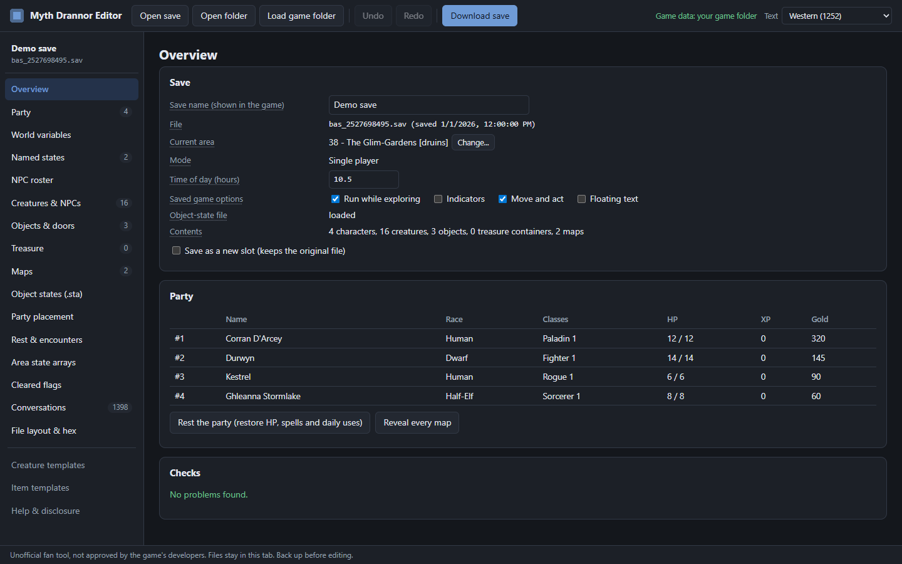

> **Unofficial, made with Claude, no support.** This is a fan tool that was created with Claude, an AI model
> made by Anthropic. It is not approved by the game's developers or publishers, it comes with no support, and it
> may not work correctly. Keep backups. You are free to fork it and make your own versions.

## Contents

- [Disclosure](#disclosure)
- [Make your own version](#make-your-own-version)
- [What you need](#what-you-need)
- [Quick start](#quick-start)
- [Finding your saves](#finding-your-saves)
- [The top bar](#the-top-bar)
- [The start page](#the-start-page)
- [Editing a save, page by page](#editing-a-save-page-by-page)
- [Editing the game's templates](#editing-the-games-templates)
- [Browsing a savegames folder](#browsing-a-savegames-folder)
- [Saving your changes](#saving-your-changes)
- [Your game's language and the Text menu](#your-games-language-and-the-text-menu)
- [How edits are kept safe](#how-edits-are-kept-safe)
- [Limits](#limits)
- [Troubleshooting](#troubleshooting)
- [For developers](#for-developers)

## Disclosure

- **Unofficial.** This is a fan-made tool. It is not affiliated with, endorsed by or approved by the developers or
  publishers of Pool of Radiance: Ruins of Myth Drannor.
- **Made with Claude.** The editor, this guide and the file format description were created with Claude, an AI
  model made by Anthropic, by reverse engineering the current release of the game (patch 1.4). No source code for
  the game was available or used. The save format, field meanings and labels are reconstructions: they may be
  incomplete or wrong, and the editor may not function correctly.
- **No support.** The editor is provided as is. Questions, bug reports and feature requests may go unanswered,
  and no fixes or updates are promised.
- **Future updates.** We do not know whether the editor will keep working with future updates or other releases
  of the game. A game update may change the files it reads and writes.
- **Use at your own risk.** Keep backups of your saves and of any game file you edit.

## Make your own version

You are free to fork the editor, change it, fix it, extend it and publish your own versions. Everything needed is
in this folder: the code is plain JavaScript with no build step, [FORMAT.md](FORMAT.md) describes the file formats
as far as they are understood, and `tests/run-tests.js` checks the save code against real files.

The editor's code is released under the [MIT license](LICENSE). Two requests from the authors, which are not
conditions of the MIT license (the license permits commercial use and does not require sharing source):

- please do not use this tool or its code commercially;
- if you share a copy or your own version, keep its source code available with it.

`js/game-data.js` holds item, creature, conversation and area data and item pictures taken from the game's own
files, and the screenshots show game content. That content belongs to its rights holders and is not covered by
the MIT license. 3D models are read from your own game folder and are not included.

## What you need

- **A current browser:** Chrome, Edge, Firefox or Safari on a desktop or laptop. Chrome and Edge can also write
  edited files straight back into a folder; the other browsers download them for you to copy into place.
- **Save files from patch 1.4.** Saves from earlier versions of the game are not read.
- **Optional: your installed game folder.** The editor has English names and item pictures built in. Loading your
  game folder adds your own game's language, 3D models of characters, creatures and objects, and lets the
  template editors open the game's own files.

Nothing needs to be installed. Open `index.html` from this folder, or use a copy someone hosts on a website.

## Quick start

1. **Back up your saves.** Copy the game's whole `savegames` folder somewhere safe.
2. **Open the editor.** Double-click `index.html`, or open a hosted copy.
3. **Open a save.** Click **Open save** and pick both files of one save, `bas_<number>.sav` and
   `bas_<number>.sav.sta`, or drop both on the page. To pick a save by its in-game name instead, click
   **Open folder** and choose the `savegames` folder.
4. **Optional: load your game folder.** Click **Load game folder** and choose the folder the game is installed in
   (the one that holds `sfDat.dat` and the `data` folder).
5. **Edit.** Choose a page on the left. Hover any underlined field name for an explanation.
6. **Save.** Click **Download save** (or **Save to folder** in Chrome and Edge when you used **Open folder**). Copy
   both downloaded files into the `savegames` folder, replacing the originals, or tick **Save as a new slot** on
   the Overview page to keep the original save as well.
7. **Load the save in the game.** Close the game, or go back to its main menu, before replacing a save it may be
   using.

## Finding your saves

Each save is a pair of files in the game's `savegames` folder:

- `bas_<number>.sav` holds the party, the world's story state and the area you are in;
- `bas_<number>.sav.sta` holds the remembered state of doors, chests and breakable objects in every area.

Always keep the two files together. The number is not a slot number: it is 4294967295 minus the time the save was
made, so newer saves have smaller numbers. The editor shows each save's in-game name and the time it was made.

If you are not sure where the folder is, search your computer for files named `bas_*.sav`.

## The top bar

| Control | What it does |
|---|---|
| **Open save** | Opens a `.sav` file and its `.sav.sta` companion. You can also drop both files on the page. |
| **Open folder** | Lists every save in a `savegames` folder by name, area and time (see [Browsing a savegames folder](#browsing-a-savegames-folder)). |
| **Load game folder** | Reads names, descriptions, conversations, area maps and models from your installed game. |
| **Undo** / **Redo** | Steps back and forward through every edit (Ctrl+Z, Ctrl+Y or Ctrl+Shift+Z). |
| **Download save** / **Save to folder** | Checks the edited save, then downloads it or writes it back (Ctrl+S). |
| **Download copy** | Appears when writing into a folder; downloads the files instead. |
| **Unsaved changes** | Shown while there are edits that have not been saved. |
| **Game data** | Shows where names come from: built in (English, patch 1.4) or your game folder. |
| **Text** | The code page your game's text is written in (see [Your game's language](#your-games-language-and-the-text-menu)). |

## The start page

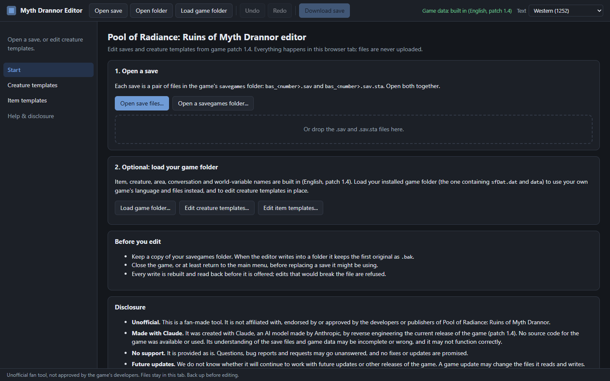

The start page offers the same actions as the top bar: open a save (or a whole `savegames` folder), load your
game folder, or go straight to the creature or item template editors, which work without a save. It also repeats
the safety notes and the disclosure.

## Editing a save, page by page

Once a save is open, the left side lists its pages. The number beside a page is how many entries it holds. The
save's in-game name and file name are shown at the top of the list.

Throughout the editor:

- hover an underlined field name to read what it does;
- lists of values (races, classes, areas, models, states) are shown by name, and flag fields are shown as named
  check boxes, with any bits the game does not use listed separately;
- every change can be undone, and nothing is written until you save.

### Overview

The Overview page (pictured at the top) shows the save as a whole:

- **Save name** is the name in the game's load and save lists. Saving later in the game under the same name
  replaces this save.
- **File** shows the file name and when the save was made.
- **Current area** is the area the party is in. **Change...** opens [Party placement](#party-placement).
- **Time of day** is in hours (0 to 24, so 13.5 is half past one in the afternoon).
- **Saved game options** are the gameplay options stored in the save.
- **Save as a new slot** writes the edited save under a new file number, so the original stays in the game's list.
- The **Party** table summarises each member's race, classes, hit points, experience and gold. **Rest the party**
  restores hit points, spells and daily uses; **Reveal every map** marks every map as fully explored.
- **Checks** lists problems the editor finds in the save. Problems that were already in the original file are
  reported separately from problems caused by your edits.

### Party

Each party member has a tab along the top. Above the sub-tabs are buttons to make the character the one
**selected when the save loads**, to **move** them left or right in the party order, and to **Heal** or **Rest**
them.

**Character** holds the name, race, gender, alignment and home area; gold, experience and banked skill points;
and hit points, including temporary hit points and damage.

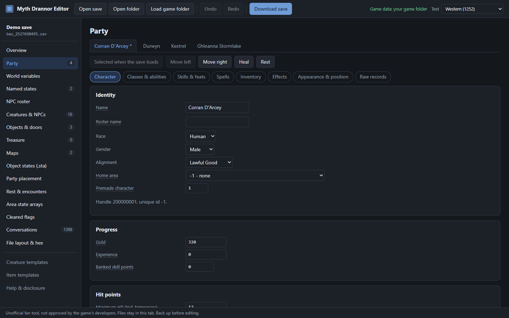

**Classes & abilities** lists the character's classes and levels. Add or remove classes and change levels; the
list keeps the order the classes were taken in. The six ability scores show the base value plus any drain and
damage, and below them are the daily ability uses spent since the last rest.

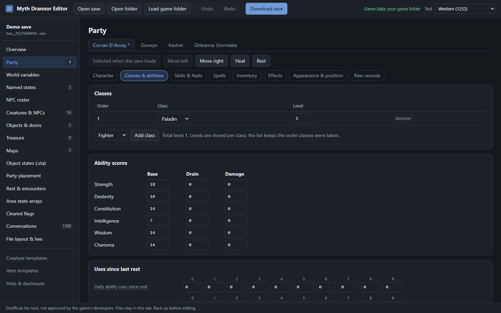

**Skills & feats** has the rank of every skill, every feat as a check box, and the class features the character
sheet shows (Turn Undead, Sneak Attack, Favored Enemy and so on).

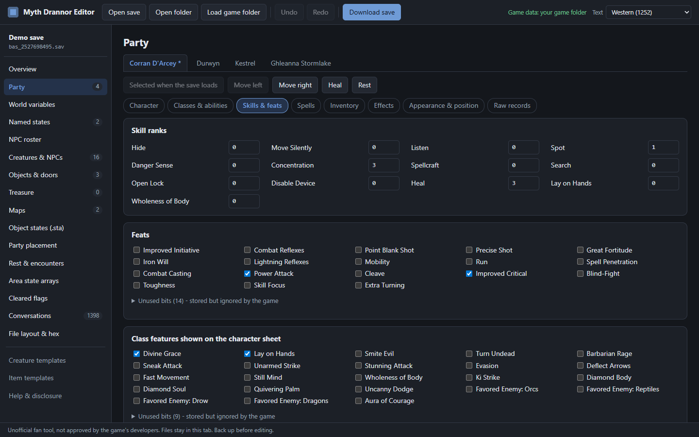

**Spells** lists the arcane spells a sorcerer has learned, with a menu to learn more (the game stores up to 43 of
the 60 learnable spells). Divine casters draw on their class list and have no list here. The spell slots used
since the last rest can be reset or changed.

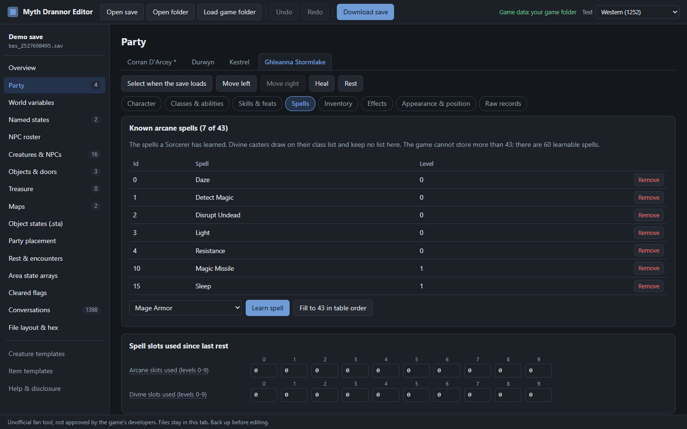

**Inventory** lists everything the character carries, with each item's picture, where it is (a worn slot or a
backpack page, row and column), charges and whether it is identified. You can:

- change an item into another one with **Pick...**;
- **Unequip** a worn item into the backpack, or **Remove** it;
- open **Details** for the item's full record;
- add any item from the game's catalog with **Browse items...** or by typing part of its name, into the backpack
  (the editor finds a free space) or straight into a worn slot.

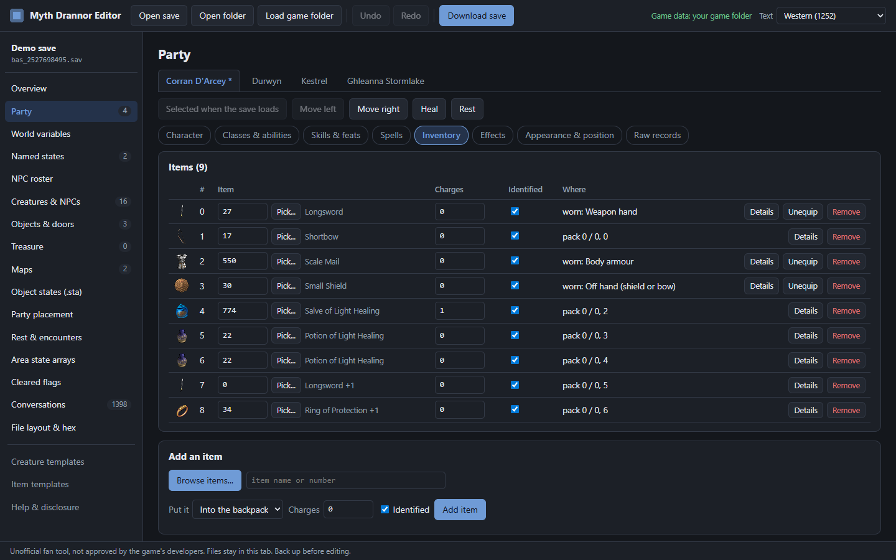

**Effects** lists the spell and condition effects active on the character (for example a Bull's Strength spell
or poison) with their duration, magnitude and caster, and whether they are suppressed. Edit or remove an effect,
or use **Remove all effects**.

**Appearance & position** shows the character's 3D model when your game folder is loaded. Drag the model to turn
it and scroll to zoom. Choose another **Model** or **Look** (texture set), or use **Choose a model...** to browse
every character, creature and object model with a preview. Further down are the appearance bytes and the
character's position in the area.

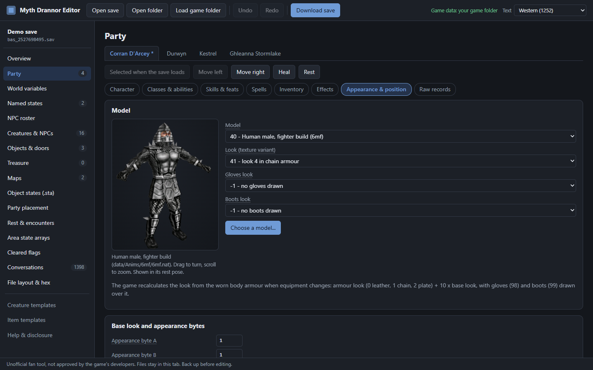

**Raw records** is a hex view of the character's records, for fields the editor does not name. Hex editing never
changes the length of a record.

### World variables

The 1,500 story variables that quests and conversations read and set. Each one is described from the game's own
conversations: the journal entries it controls, the lines spoken when it is set, and where it is checked. Use the
search box to find a quest or a line of dialogue, tick **Non-zero only** to see what has happened in your game, or
show only the variables one script file declares. The value box suggests the values the game itself uses, and
**Details** shows the full description.

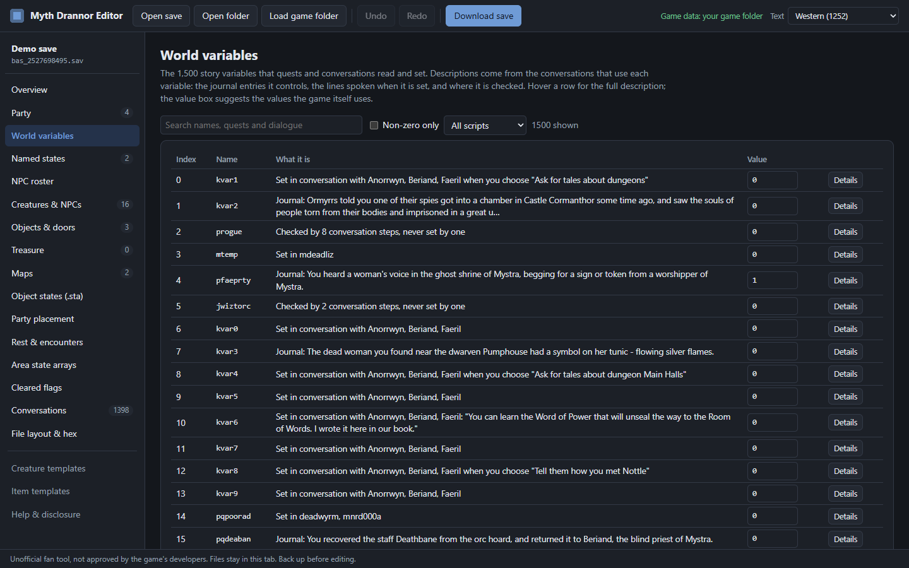

### Named states

Things the game remembers by name rather than by number. **Encounter** states record how a named fight ended
(2 means defeated, so it will not happen again). **Named object** states record named doors, gates, levers and
other objects that scripts refer to. Change a value, remove an entry, or add one under **Add or change**; the name
box suggests every name the game's scripts declare.

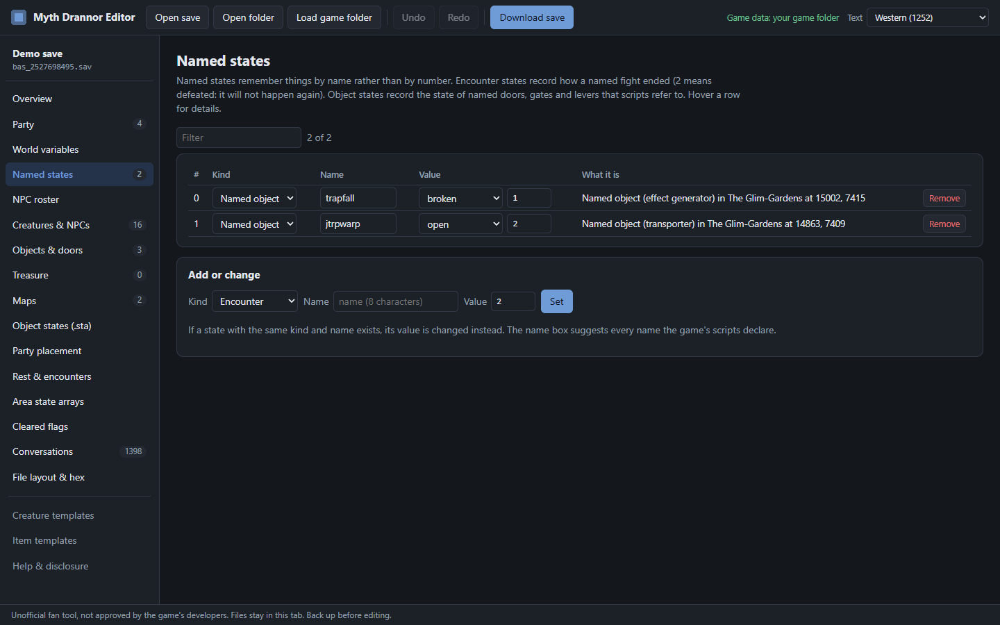

### NPC roster

The game's fixed list of named NPCs. Tick **Dead** to mark one as dead. **When clicked** decides what clicking the
NPC in the world does: talk, trade, join the party, or nothing. Conversations change it as the story moves on;
hover a row to see where. **Buys at** and **Sells at** are merchant price factors (0 for NPCs who do not trade).

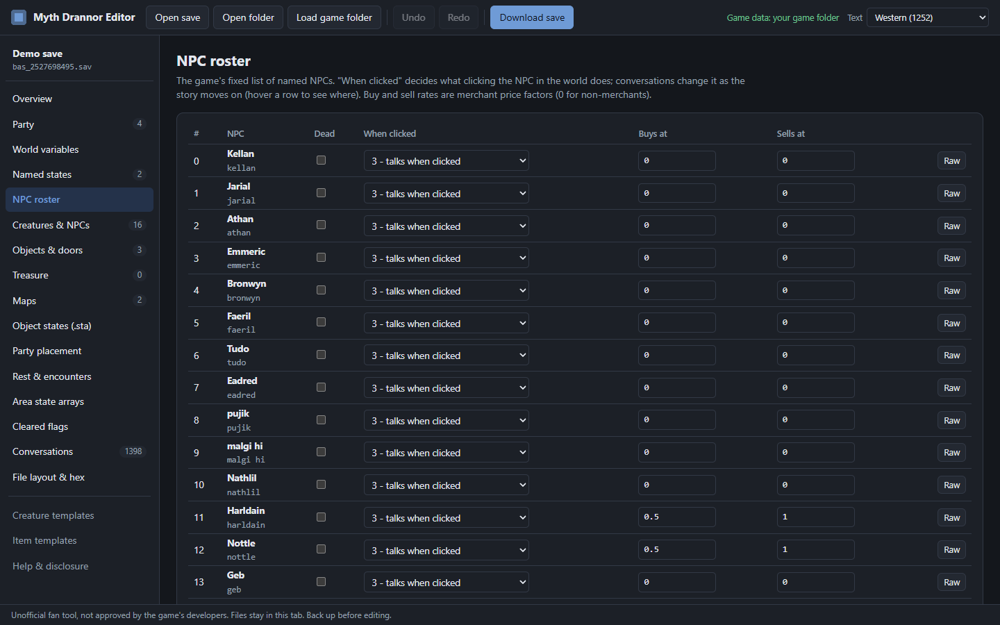

### Creatures & NPCs

Every creature and character in the current area other than the party. Pick one from the list to edit it:

- name, position and facing;
- its **creature template** (switching it turns the creature into another kind), AI mode and team;
- hit points, with **Heal** to restore them;
- its 3D model, inventory and active effects;
- **Remove from save** to delete it.

**Heal all** and **Remove all from this save** act on every creature in the list. A note explains which values
belong to this one creature and which come from its template, with a button to edit the template.

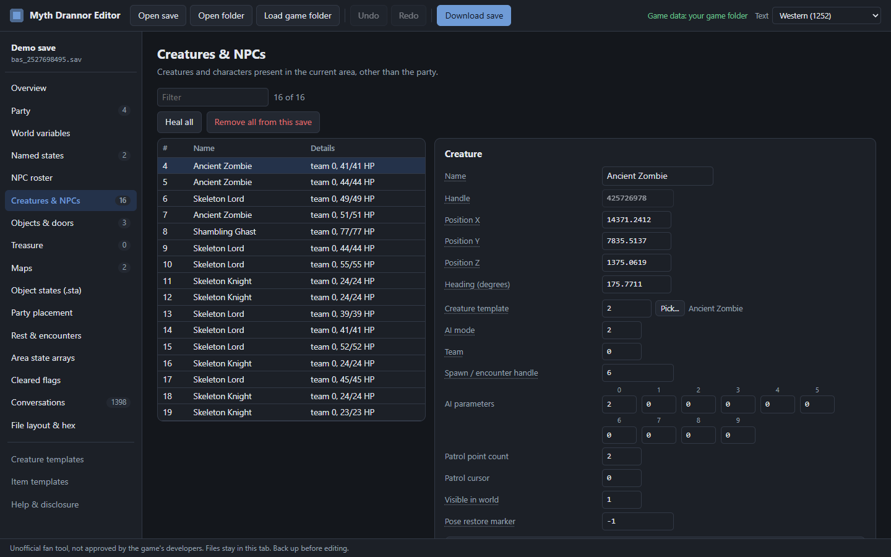

### Objects & doors

The current area's interactive objects: doors, levers, containers, transporters, traps and breakables. Each has a
state (open, closed, broken and so on), lock and trap flags, hit points, a colour (with a colour picker), a model
and an inventory. Clearing the lock or trap flag leaves a door unlocked or a trap disarmed in this save.

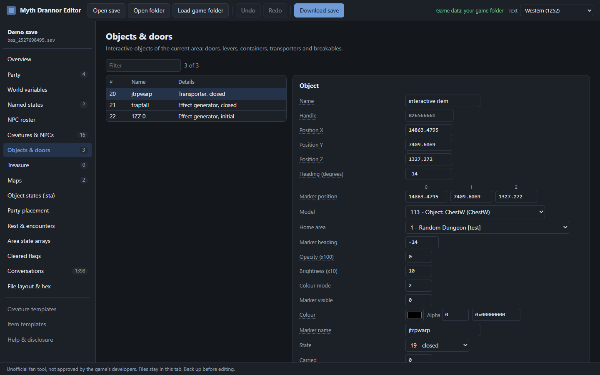

### Treasure

Treasure piles and containers in the current area: the gold in each and the items inside. Items are added and
removed the same way as in a character's inventory.

### Maps

Every map the party has visited. Choose a map at the top, then:

- **Exploration** shows which parts of the map are uncovered. Click or drag on the grid to uncover or hide cells,
  or use **Reveal all** and **Hide all**.
- **Map notes** are the notes placed on the map in the game. Change their text or position, remove them, or add new
  ones (or Shift-click on the grid to place a note).
- **Area markers** are the symbols the map shows for each visited area.

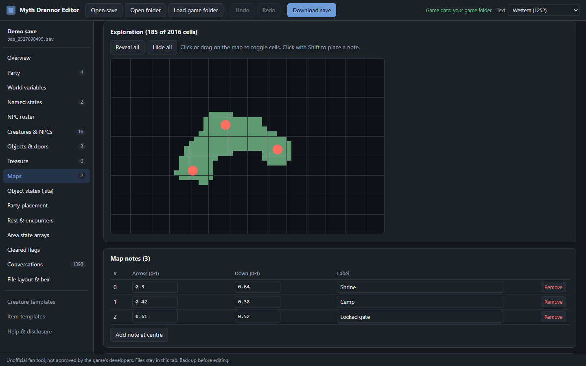

### Object states (.sta)

Every area has many doors, chests, barrels, crates and other numbered objects. The `.sav.sta` file remembers what
happened to each of them, one table per area: that is how a smashed barrel stays smashed and an opened door stays
open when you come back. Choose an area, then change an object's saved state or its **Lock cleared** flag. An
object with no entry looks the way the area places it. **Clear this area** returns every object in the area to its
starting state, for example to refill containers or restore doors.

If a save was opened without its `.sav.sta`, this page offers to add the file or create an empty one.

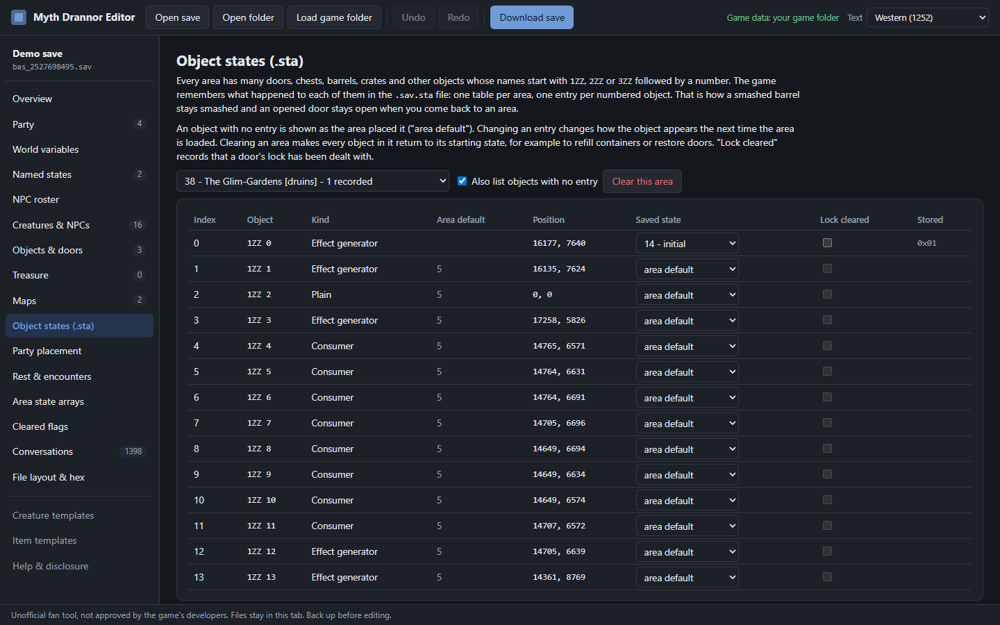

### Party placement

Move the party without walking:

- **On load** shows which character is selected and the arrival marker, if any, the game uses to place the party
  when the save loads.
- **Move the party within this area**: click the area map (north is up, with walkable ground, arrival points,
  objects, conversation spots, the party and creatures marked) or pick a marker, then **Move party here**. The
  whole party moves together and keeps its formation. Use **Zoom in**, **Zoom out** and **Fit** to find your way.
- **Place at an arrival marker** sets the entry point the game lines the party up at when the save loads.
- **Move to another area** (experimental) sends the party to a marker or point in a different area. The current
  area's creatures, objects and cleared flags are removed from the save, and the destination area's state is reset
  so the game rebuilds it. Keep the original save.

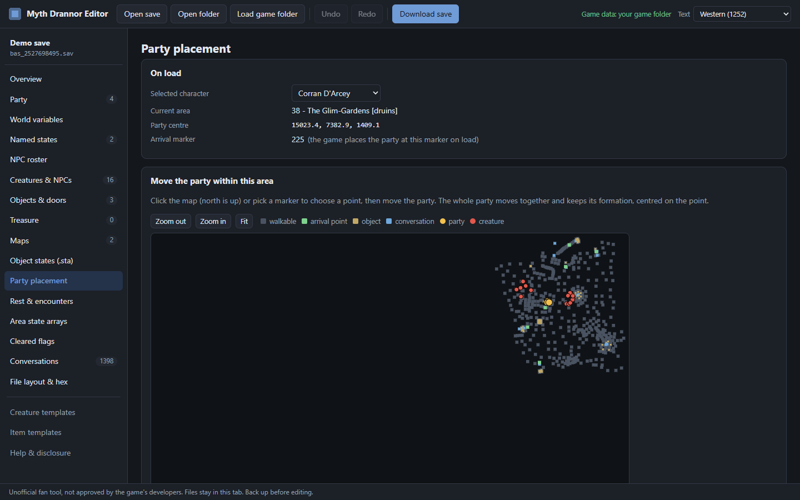

### Rest & encounters

Resting rules for the current area (whether resting is allowed and safe, and which encounters can interrupt it),
encounters the game is tracking, important items waiting to reappear in the world, and the party list.

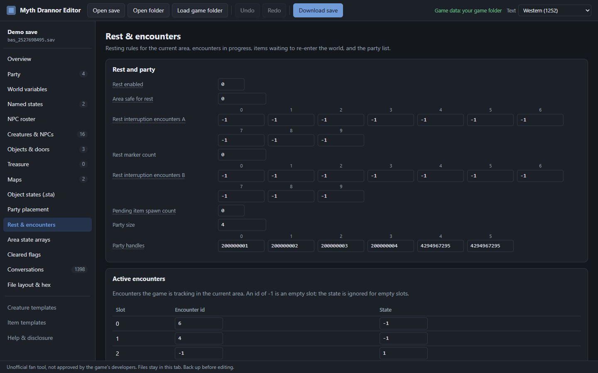

### Area state arrays and Cleared flags

Two records of what the game has already used up:

- **Area state arrays** keep, per area, the markers the game has activated. Resetting an area makes its markers
  behave as on a first visit.
- **Cleared flags** keep one byte per marker of the current area, grouped by map cell, recording which markers are
  cleared or used up. **Clear every flag** resets them.

### Conversations

How far each conversation has gone: which lines have been seen and which answers chosen. Each row shows the
speakers and the opening line, and the filter finds a conversation by name or speaker. **Bytes** opens the raw
record; byte edits must keep the record's length.

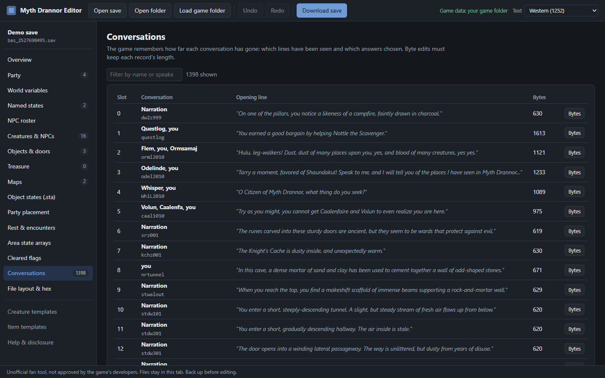

### Multiplayer world

Shown only for multiplayer saves: the random-world settings the save was made with.

### File layout & hex

Where each section sits in the file as it would be written now, how many bytes have changed since the file was
opened, and a read-only hex view of the whole save.

## Editing the game's templates

Templates are game files, not saves. A template change applies to every game played with that installation,
including creatures and items already in your saves. Keep a copy of the original file.

Open a template file from the loaded game folder, or pick the file yourself. Chrome and Edge can save straight
back into the game folder and keep the first original as a `.bak` file; other browsers download the edited file
for you to copy into the game's `data` folder. **Close file** closes it without saving.

### Creature templates

`data/monsters.mon` holds the statistics every creature of a kind shares. Pick a creature to see its worked-out
hit points, armour class, attacks, saves, initiative, speed and experience, its immunities and creature kinds,
and its model in 3D. Every field can be edited: abilities, hit dice, special abilities, arcane and divine spells,
model and look, attack rows and loot.

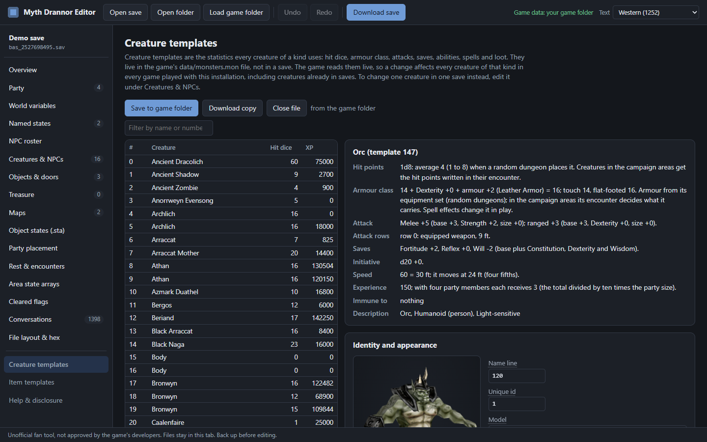

### Item templates

`data/TEE.trs` holds every item in the game, and `data/str/TEE.str` holds their names. Pick an item to change its
identified and unidentified names, picture, 3D model, type, value, weight, backpack size, worn slots, the classes
that can use it, damage and critical range, armour values, charges, its look when worn, and its effects (bonuses,
spells and conditions). **Duplicate as a new item** copies an item to start a new one. The **Equipment sets** tab
edits the loot tables that chests, placed treasure, broken containers, treasure-awarding scripts and creatures in
random dungeons draw their items from.

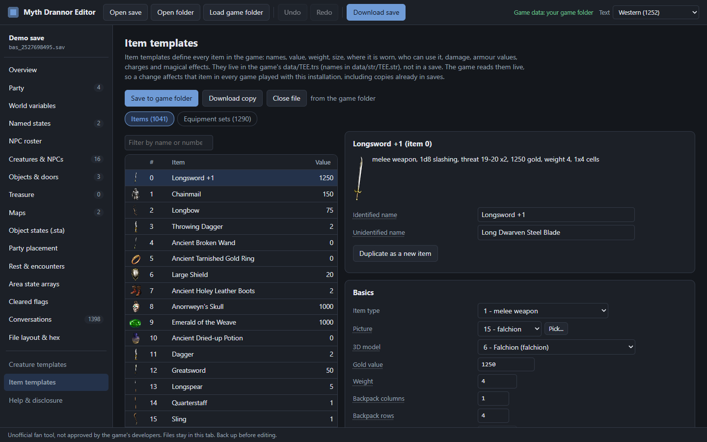

## Browsing a savegames folder

**Open folder** lists every save in a folder by its in-game name, area and time, and shows whether its `.sav.sta`
companion is present. Click a save to open it. In Chrome and Edge the editor can then write edited saves straight
back into the folder; other browsers can read the folder but download edited saves.

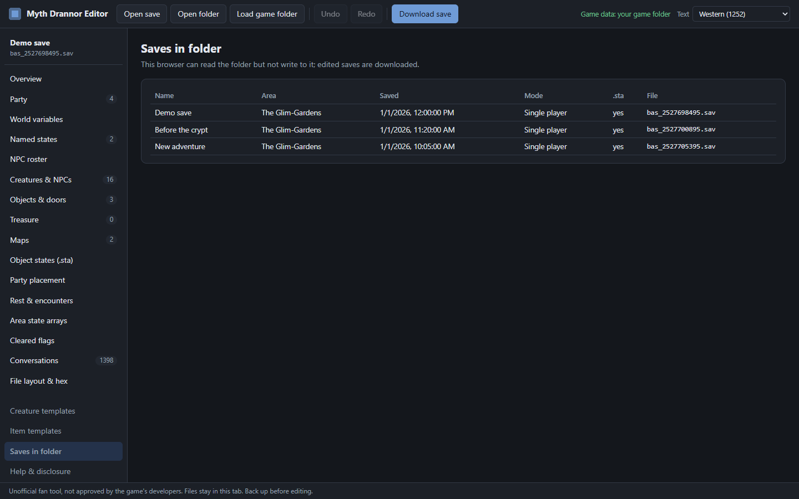

## Saving your changes

When you click **Download save** or **Save to folder**, the editor rebuilds the save, reads it back and checks it
before anything is written (see [How edits are kept safe](#how-edits-are-kept-safe)). If the check finds a problem
the game may not handle, you are shown the list and can cancel; a save that cannot be read back is never offered.

- **Download save** downloads the `.sav` and its `.sav.sta`. Copy both into the `savegames` folder.
- **Save to folder** (Chrome and Edge, after **Open folder**) writes into the folder directly. With **Keep the first
  original as .bak** ticked on the Overview page (it is on by default), the first time a file is overwritten its
  original is kept next to it as `<name>.bak`.
- **Save as a new slot** on the Overview page writes the save under a new file number instead of replacing it.

Close the game, or return to its main menu, before replacing a save it may be using.

## Your game's language and the Text menu

The built-in names are English. With your game folder loaded, names, descriptions and conversations come from your
own game, in its language. Text is read in your game language's code page: Western, Central European (Polish),
Cyrillic (Russian), Traditional Chinese (Big5) or Simplified Chinese (GBK). The editor picks it from the game's
text when you load the game folder or a `.str` file. If names still look like random symbols, choose another code
page under **Text** at the top right.

Only the game's own `data` folder is read. Copies of it in subfolders (for example language packs) are ignored.

## How edits are kept safe

- The parser reads every section of the file and requires the structure to end exactly at the end of the
  file. Bytes the editor does not model are written back unchanged, so an unedited save rebuilds byte-for-byte.
- Counts and lengths (entities, inventory, effects, map notes, followers, creature attacks and so on) are
  recalculated when the file is written.
- Before anything is written the edited save is rebuilt, read back, and checked: party members must exist and
  be player characters, the selected character must be in the party, worn slots must not overlap, item handles
  must be unique, and class and spell lists must fit their storage. Problems already present in the original file
  are reported separately.
- Hex editors never change the length of what they edit; records are added and removed only through the
  structured editors.
- Undo and redo cover every edit (Ctrl+Z, Ctrl+Y). Ctrl+S saves.

## Limits

- Only version-37 saves (patch 1.4) are read. Earlier versions are rejected.
- Moving the party to another area is experimental: the current area's creatures, objects and cleared flags
  are removed from the save, and the destination's area state is reset so the game rebuilds it.
- Creature and item template changes apply to every game played with that installation, including creatures
  and items already in saves.
- Models are shown in their rest pose without animation, and only when the game folder is loaded (their files
  are too large to build in).
- Not every byte of the save is understood. The raw hex views show everything the editor does not name.

## Troubleshooting

**Names or conversations look like random symbols.** The text is being read in the wrong code page. Choose your
game's language under **Text** at the top right.

**"Could not draw this model".** Models are read from your game folder. The message names the folder that was
searched: load the folder the game is installed in, the one that holds `sfDat.dat` and `data`.

**The page still behaves like an older version.** After replacing the editor's files, close any tab that still has
the old page open, or reload it with Ctrl+F5, then load the game folder again. The version is shown under
**Help & disclosure**.

**"save format version ... is not supported".** The save comes from another version of the game. Update the game
to patch 1.4, load the save there and save again.

**The game does not show my change.** Make sure both files were copied into `savegames` and that the game was
closed or at its main menu when they were replaced. Some values are recalculated by the game when the save loads;
the field's explanation says so where this is known.

## For developers

### Hosting

The editor is static files with no build step and no external requests:

```
myth-drannor-editor/
├── index.html
├── css/
│   └── editor.css
├── js/
│   ├── bytes.js
│   ├── tables.js
│   ├── savefile.js
│   ├── statefile.js
│   ├── scripts.js
│   ├── gamedata.js
│   ├── game-data.js
│   ├── model.js
│   ├── ui.js
│   └── app.js
├── screenshots/
│   └── (images used by this README)
├── tools/
│   └── build-game-data.js
├── tests/
│   └── run-tests.js
├── FORMAT.md
├── LICENSE
└── README.md
```

Serve the folder from any static host, or open `index.html` from disk. Writing directly into a folder needs the
File System Access API (Chrome and Edge); other browsers download the edited files instead.

`index.html` puts the release version on every script and stylesheet (`?v=1.0.1`), so browsers fetch new files
after an update. Change all of them together when releasing; `tests/run-tests.js` fails if they differ.

### Rebuilding the built-in game data

`js/game-data.js` is generated from an installed copy of the game with Node.js 18 or later:

```
node tools/build-game-data.js <game folder> [language name]
```

Run it against a different language's installation to build the editor's names and descriptions in that
language.

### Tests

```
node tests/run-tests.js [--game <game folder>] [--list <file of save paths>] <save file or folder>...
```

Every save found must rebuild byte-for-byte, and a set of edits (items, classes, spells, world variables,
named states, map notes, party relocation and an area move) is applied and verified by reading the result back.
With `--game`, the label tables, conversation index, creature template file and built-in data format are also
checked against the game's own files.

The file formats are described in [FORMAT.md](FORMAT.md).

### About the screenshots

The screenshots were taken with a demonstration save: the game's premade party, filler save names and notes, and
a game folder loaded for names and 3D models. They show the dark colour scheme; the editor follows your system's
light or dark setting.
